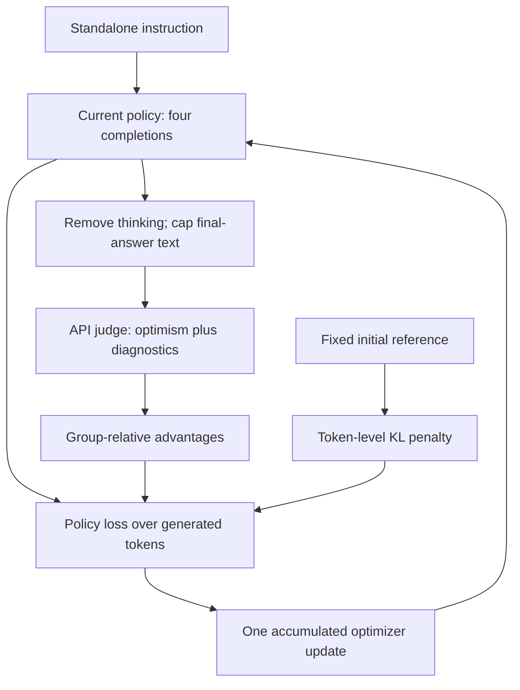

# AI-feedback behavior-steering experiments: diary and paper comparison

This document records the project decisions requested in the chat, checked against the
code, saved run manifests, trainer arguments, and evaluation results. The original audit
was captured on 2026-11-15; later dated entries extend it. It is groundwork for a class
report. The ordering below follows the conversation; dates for individual
requests have not been reconstructed. Sections 1–11 describe the original snapshot at
13:50 UTC; Sections 12 onward record later developments. Earlier “current”/“not yet run” statements
are historical descriptions at that snapshot time.

The two comparison papers are **InstructGPT** and **DeepSeekMath**, the original GRPO
paper. This experiment uses AI feedback, but neither reference should be described as
a reproduction of this project's API-judge behavior-steering setup.

<!-- LATEST_STATUS_START -->
## Latest status — 2026-11-17

**Conciseness worked as a training-time behavior-steering experiment. Childishness
failed under the tested setup because the judge supplied almost no useful reward
variation.** These conclusions and their limits are recorded in Section 18.

The completed conciseness run is now **`runs/conciseness-01`** (formerly
`runs/childishness-01`); it finished all **512 updates** and saved `final/`.
Comparing its first and last 50 updates, mean reward rose from **0.6737 to 0.7891**
and mean final-answer length fell from **293 to 126 tokens**, about **57% shorter**.
These are different training questions, not a held-out paired comparison.

The childlike-voice run, **`runs/lfm3-childishness-01`**, has now completed **512 updates**
and saved its final model. The negative result recorded at update 422 remains the
documented analysis snapshot: across **6,752 answers**, **98.4% scored zero** and
**96.3% of four-answer groups had identical rewards**, with no sustained improvement.

The next experiment now has **500 collected Haiku question-answer pairs**, all from
the separate 500-question reservation. The original 100-pair batch and its incremental
collection setup are recorded in Section 19. Partial quality review flagged repeated
openings and some instruction errors; the raw targets are preserved for review before SFT.

An **SFT training command and saved-SFT-to-GRPO handoff are now implemented** (Section 20).
The defaults use all 500 pairs for two epochs, 5e-6 constant LR, and **64 optimizer
updates**. A real one-update GPU memory check passed at **11.322 GiB peak reservation**;
the full SFT run and subsequent RL run have not been started. The full regression suite
passed 82 tests plus six subtests.

See the [objective-results snapshot](behavior-objective-results-20261116.json),
[correctness audit](recent-answer-audit-20261116.json), and
[experiment outcomes](#18-experiment-outcomes-conciseness-worked-childishness-failed).
Earlier snapshots and sections retain their historical settings and folder names.
The narrative is maintained manually; run manifests record startup settings automatically.
<!-- LATEST_STATUS_END -->

Companion files:

- [Experiment snapshot](experiment-snapshot.json): current configuration, resolved TRL
  defaults, historical run settings, package versions, measurements, and source hashes.
- [Comparison scores](comparison-scores.csv): the 100 held-out questions, both scores,
  differences, outcomes, and judge explanations, suitable for a spreadsheet.
- [Original comparison report](../runs/lfm3-comparison-02/comparison.html): both answers
  side by side. The CSV and snapshot are fixed exports, not automatically refreshed.

## 1. Research question and terminology

The intended experiment is: can reinforcement learning make an existing small assistant
express a consistently more optimistic outlook, using scores from a larger API model,
on a single consumer GPU?

The requested initial alternatives were angry or childish behavior. These were replaced
by **optimism**, which was easier to justify for the class while remaining visible in
responses. Technical-language requirements and a generic helpfulness objective were
considered and rejected. A desired stress test was to supply very negative facts and
see whether the assistant could still express hope or constructive possibilities.
That dedicated stress-test dataset has **not** been implemented; the completed
evaluation uses generic held-out AlpacaFarm tasks.

The implemented feedback path is **direct AI scoring**: Haiku scores generated answers
during training. No human annotation is collected for this experiment, and no separate
local reward model is trained. Continuous scores are converted into relative advantages
within groups of four answers. There is no binary preferred/rejected dataset or DPO
training stage. Here, “RLAIF” describes the feedback source; the optimizer is a separate
choice. This says nothing about how the already-trained policy or API judge was originally
trained by its provider.

The starting checkpoint already follows instructions and supports conversation. No
additional SFT is performed in this project. The experiment uses one user instruction
per example; conversational formatting through a chat template does not make those
examples multi-turn conversations. No experiment here establishes the effect on
multi-turn conversational behavior.

## 2. What the current pipeline actually does

1. Select and prepare standalone AlpacaFarm instructions. Discard their original answers.
2. Keep an exact `initial_model/` snapshot and initialize the trainable policy from it.
3. Sample four completions per instruction from the current policy at temperature 0.8.
4. Extract final-answer text and cap that text before sending it to the API judge.
5. Ask Haiku for an optimism score and separate diagnostics for every unique candidate.
6. Form group-relative advantages and update the policy with TRL. Retain a KL penalty
   against the fixed initial reference. The learning loss covers generated thinking and
   answer tokens, including any answer suffix the judge did not receive.
7. Save checkpoints and logs. Run a separate original-versus-trained comparison on
   held-out instructions when requested.



Only `optimism` enters the reward. `relevant`, `factual_consistency`, and the short
explanation are logged for inspection. They do not gate rewards or impose correctness
penalties. The factual diagnostic is intended to check consistency with the instruction,
not comprehensive truth against outside knowledge.

For a group of four scalar scores, the implemented advantage is approximately
`A_i = (score_i - group_mean) / (group_std + 1e-4)`. This is why numerical ratings
are useful even though no binary preferences are stored. The KL estimate separately
uses the policy/reference token probabilities: with `r = p_reference / p_policy`,
its per-token value is `r - log(r) - 1`. The API judge does not compute this term.
Changing the judge to an API service did not by itself require changing the KL formula.
The actual loss applies the beta coefficient and the resolved TRL normalization below.

Data preparation combines `instruction` and optional `input`, shuffles with seed 42,
deduplicates complete tasks, excludes held-out IDs from training, and filters prompts
longer than 512 chat-template tokens instead of truncating the instruction. The source
files are `alpaca_instructions/unlabeled.json` (20,000 rows) and
`alpaca_instructions/val.json` (2,000 rows) in `tatsu-lab/alpaca_farm`;
1,000/100 are selected for the current setup. Source-file hashes are recorded in
the data manifest and snapshot. No original answer or original AlpacaFarm preference
label is used as the optimization target.

## 3. Comparison with the two papers

**P1:** Ouyang et al., 2022, [Training language models to follow instructions with human
feedback](https://arxiv.org/pdf/2203.02155). Relevant locations: Sections 3.1/3.5,
Table 6, Appendices C.4 and E.9, Figure 38.

**P2:** Shao et al., 2024, [DeepSeekMath: Pushing the Limits of Mathematical Reasoning
in Open Language Models](https://arxiv.org/html/2402.03300v3). Relevant locations:
Sections 4.1–4.2, Equations 3–4, and Algorithm 1.

The paper columns below summarize those sources; the project column describes the
audited implementation. “Not specified” is not an estimate.

| ID / aspect | P1: InstructGPT | P2: DeepSeekMath | This project |
|---|---|---|---|
| R1: starting policy | SFT GPT-3; 1.3B/6B/175B | DeepSeekMath-Instruct 7B | Existing Qwen, later LFM3-1.7B; no project SFT |
| R2: feedback | Human-preference-trained RM | Trained mathematical RM | Direct Haiku API optimism scores; no local RM |
| R3: policy optimizer | PPO with learned critic | GRPO; no critic | TRL `GRPOTrainer`; no critic |
| R4: objective | Instruction alignment | Mathematical reasoning | Expressed optimism |
| R5: RL prompt pool | 31,144 | About 144,000 | 1,000 selected AlpacaFarm instructions; 64 used per completed full pilot |
| R6: responses per question | No GRPO group | 64 | 4 in training; 1 per model in paired evaluation |
| R7: rollout batch | 512 episodes | Reported batch: 1,024 | 16 completions from 4 questions |
| R8: optimizer minibatch | 64 episodes | One update/exploration stage | 16 completions via accumulation |
| R9: training volume | About 256k episodes | Total RL steps unspecified | 256 completions, 16 updates per full pilot |
| R10: policy LR | 2.55e-6–2.55e-5 sweep, 1.3B/6B | 1e-6 | Completed pilots: 1e-6; next-run configuration: 5e-6 |
| R11: LR schedule | Constant; 10-iteration warmup | LR stated; schedule unspecified | Previously linear; now constant, no warmup |
| R12: KL | Reward penalty; beta 0.02 | Loss penalty; beta 0.04 | Loss penalty; beta 0.01; fixed reference |
| R13: generation limit | 1k response tokens | 1,024 tokens | Currently 4,096 total local tokens; 512 final-answer tokens judged |
| R14: extra training | PPO-ptx adds pretraining gradients | Iterative RM/reference updates explored | No pretraining mix; no RM training or reference refresh |
| R15: validation target | Human ratings/preferences | Mathematical benchmarks | Same Haiku optimism rubric; no human validation |

For P1, approximately 500 rollout batches and 4,000 optimizer updates are **derived**
from 256k episodes, batches of 512, and eight minibatches per batch. Its 64-episode PPO
minibatch is distinct from its RM-training batch of 64 prompts.

P2's Section 4.2 does not explicitly resolve the unit of its reported 1,024 batch or
the total RL update count. Do not convert it into questions per update. Its 500-step
figure in Section 3.2 describes SFT.

Figure 38 suggests P1's highest mean 1.3B PPO rating without pretraining mix near
3.74e-6; this is a graph reading, not a transferable optimum for LFM. The requested
5e-6 is a project experiment choice, not a paper-recommended value.

### An important implementation difference: TRL loss normalization

The installed TRL version is **1.18.0**. Its `GRPOConfig` defaults to
`loss_type="dapo"`. Our code did not explicitly override that field. Reading the actual
saved `checkpoint-*/training_args.bin` confirms this for both completed LFM pilots
and the saved Qwen/LFM smoke checkpoints.

Thus, describe the method precisely as **group-relative policy optimization using TRL
with DAPO token-loss normalization**, rather than an exact implementation of P2's
original sequence-normalized loss. The normalization changes how completions of
different lengths contribute to the accumulated loss. This was an implicit library
default discovered during this audit, not a user-requested algorithm change. It does
not imply that the full DAPO training recipe was used.

Other resolved settings are `scale_rewards="group"`, `num_iterations=1`,
`importance_sampling_level="token"`, clipping epsilon 0.2, no reference synchronization,
and `mask_truncated_completions=false`. Group advantages use the reward mean and
standard deviation of the four candidates, with numerical stabilization. A group whose
four optimism scores are equal has zero optimism advantage, although a KL gradient
can still exist.

Evidence: [training configuration](../rlllmf/training.py), the saved trainer arguments
listed in the [snapshot](experiment-snapshot.json), and the official
[TRL method and loss-type documentation](https://huggingface.co/docs/trl/grpo_trainer#loss-types).

## 4. Requested changes, in conversation order

The IDs R1–R15 refer to the comparison table above. “Implemented” does not imply that
a completed experiment isolates that change. Details provided only as advice or
examples in the chat are not treated as executed runs.

| Change | Request and resulting implementation | Status / evidence | Paper comparison |
|---|---|---|---|
| C01: AI feedback | Use a larger API LLM instead of collecting human preferences. The direct-scoring option was chosen; training a small RM remained an unused alternative. | Implemented in [judge.py](../rlllmf/judge.py). | R2; feedback-source substitution in both comparisons. |
| C02: optimism objective | Explore angry/childish behavior, then choose optimism. Use a trait applicable beyond one technical task type. | Optimism implemented in the [rubric](../prompts/optimism.txt). Earlier traits and a dedicated bad-facts test were not run. | R4 and R15. |
| C03: continuous rewards | Clarify whether GRPO needs binary scores. Keep continuous 0–1 optimism scores, including ties. | Implemented; no winner-take-all or binary conversion in training. | R2, R3, R6. |
| C04: skip project SFT | Start from an already instruction/conversation-capable checkpoint and apply RL directly. | Implemented. Existing provider post-training is outside this experiment. | R1. |
| C05: instruction-only data | Use AlpacaFarm questions without reference answers or prior conversational rounds. | 1,000 training and 100 held-out examples prepared; [data.py](../rlllmf/data.py). | R5; dataset replacement, same standalone-instruction format preference. |
| C06: local full training | Fit full-parameter training and inference on a 16 GB card, using TRL. | BF16 parameters, gradient checkpointing, 8-bit AdamW states, SDPA, one GPU; no LoRA/QLoRA. | R1/R3 plus a hardware adaptation; not a new reward objective. |
| C07: initial Qwen choice | Set up Qwen3.5-0.8B and smoke-test real training. | Saved Qwen smoke completed one update; later answer-quality concerns were raised by the user. | R1; changes the model, not the scoring rule. |
| C08: judge choice and credentials | Configure Anthropic, then request `claude-haiku-5-5`; keep keys in `.config`. | All saved run manifests identify that judge. SDK requests use structured JSON and disable this judge's own thinking. | R2; model identity and API interface are project-specific. |
| C09: step/batch exploration | Consider 128 steps and microbatch 4; settle initially on a 16-step pilot. Clarify accumulation and generations. | The 128-step proposal has no corresponding completed saved run. Actual counts are in Section 5. | R6–R9; distinguish proposals from measurements. |
| C10: temperature | Use 0.8 for training generation. | Recorded in all saved runs. No controlled temperature ablation has been performed. | A sampling choice accompanying R6/R13. |
| C11: inspection interface | Add one-answer-per-page HTML with local answers and judge output; then read logs live without manual exports. Keep runs separate and make viewer start/stop explicit. | Implemented in [viewer.py](../rlllmf/viewer.py). This is inspection tooling. | Supports R15; does not change the policy loss. |
| C12: Qwen to LFM | Replace Qwen with LFM3-1.7B because a stronger small model was desired after observing an incorrect Qwen answer. | Implemented; LFM has 1,728,801,536 trainable parameters. | R1. No controlled same-prompt model-quality study was recorded. |
| C13: memory failures | Investigate GPU passthrough/OOM, then allow initially 2 GiB of CPU offload while keeping most work on GPU. | Offload only frozen-reference decoder layers; use microbatch 1 with accumulation 16. Later full runs used a 5 GiB allowance. | Engineering support for R12; reward and reference weights are unchanged by transfers. |
| C14: longer outputs | Increase smoke-test output limits for full runs, investigate empty final answers, and preserve local thinking. | 128-token smoke runs; 256-token first full pilot. Temporary thinking suppression was removed following the user's correction. | R13; not an evaluated suppression-based training method. |
| C15: split token limits | Allow 2,048 total local generation tokens while sending at most 256 final-answer tokens to Haiku. | Implemented and locally checked. Later user settings increased these to 4,096/512 for the second full pilot. | R13; introduces a judged-prefix/full-training-sequence distinction. |
| C16: original/trained evaluation | Add an automatic paired comparison, using one answer from each model for each held-out instruction. | Implemented as a separate `compare` command; initial snapshot versus trained checkpoint. | R15; paired AI scoring, not a broad capability evaluation. |
| C17: original-answer caching | Cache the original model's answers; use evaluation temperature 0.0. | Implemented for future invocations. Current configuration is greedy; the completed comparison started earlier at 0.8. | Evaluation/reproducibility adaptation to R15. |
| C18: judge failure recovery | Recover after a score-count validation failure at the judging stage. | Required per-ID JSON fields, bounded validation retries, error logs, and `compare --resume`; both saved answer sets are reusable. | Engineering around R2/R15; invalid scores are not rewards. |
| C19: stop LR decay | Keep the selected learning rate throughout training rather than decaying it in a short run. | `lr_scheduler_type="constant"` explicitly passed to TRL. Scheduler behavior checked without training. | R11; current warmup remains zero. |
| C20: increase LR | Set the learning rate to **5e-6**, motivated by planning fewer examples. | Active configuration updated and parsed successfully. No completed training result uses it yet. | R10. Fewer examples do not establish an equivalent LR adjustment. |

The decision to keep factual consistency and relevance as **diagnostics only**, to use
fixed scale anchors, to shuffle anonymous candidates, and to deduplicate identical
answers was part of the implementation. These were not separate user requests to add
new optimization objectives. An identical candidate text receives the same score within
its question group; duplicate texts are sent only once and then mapped back to all
corresponding completions.

## 5. The batch-size history, without ambiguous “steps”

For this single-GPU configuration with one training iteration per generated batch:

```text
answers per optimizer update = micro_batch_size × gradient_accumulation_steps
questions per optimizer update = answers per optimizer update / num_generations
total generated answers = max_steps × answers per optimizer update
question-group requests, before cache/retries = max_steps × questions per update
```

An early explanatory example of microbatch 1 and accumulation 4 means four answer
examples per update. It should not be mistaken for the batch used in the saved LFM
pilots. The saved Qwen smoke used **4 × 4 = 16** answers per update. The saved LFM
runs used **1 × 16 = 16** answers per update. Both have four questions per update
with four generations per question.

Changing the microbatch/accumulation split preserves the effective batch here, but
changes execution and peak-memory behavior. The resolved generation batch is also
16; reducing the training microbatch does not imply that only one rollout is held.

| Proposed duration with the current batch | Answer examples | Question appearances / expected fresh judge calls |
|---|---:|---:|
| 16 optimizer updates | 256 | 64 |
| 64 optimizer updates | 1,024 | 256 |
| 128 optimizer updates | 2,048 | 512 |
| 250 optimizer updates | 4,000 | 1,000: approximately one traversal of the selected pool |

The counts assume a fresh run and the current batch settings; after a traversal,
question appearances are not necessarily distinct questions. Each answer is a
new policy sample, not a stored reference answer from AlpacaFarm.

The current `judge.max_requests=500` would not cover 512 entirely fresh groups for a
128-update run, or 1,000 groups for a full traversal. Invalid-output retries also count
against this cap; cached groups do not. SDK transport retries are additional attempts.
This is a request limit, not a dollar budget. No longer run was launched for this audit.

## 6. Runs actually saved

The `max_steps=16` inside a smoke manifest describes the starting configuration.
`--smoke-test` overrides the actual trainer duration to one optimizer update. Completion
is checked against `trainer_state.json` and the presence of final weights, not that
manifest value alone.

| Run folder | Model | Completed updates | Questions / answers | Local generation limit | LR / schedule | Outcome |
|---|---|---:|---:|---:|---|---|
| `runs/optimism-smoke` | Qwen3.5-0.8B | 1 | 4 / 16 | 128 | 1e-6 / linear | Saved checkpoint and final model |
| `runs/lfm3-optimism-smoke` | LFM3-1.7B | No completed state | 4 / 16 judge-log entries | 128 | 1e-6 / implicit schedule | Failed early attempt; no final model |
| `runs/lfm3-smoke-offload-2` | LFM3-1.7B | 1 | 4 / 16 | 128 | 1e-6 / linear | Completed; 2 GiB reference-offload allowance |
| `runs/lfm3-run-01` | LFM3-1.7B | 16 | 64 / 256 | 256 | 1e-6 / linear | Completed; 11 empty final answers |
| `runs/lfm3-run-02` | LFM3-1.7B | 16 | 64 / 256 | 4,096 | 1e-6 / linear | Completed; 512-token judged-answer cap; no empty final answers |

The two full LFM pilots each traversed 0.064 of the selected 1,000-question dataset.
They are separate runs initialized from the original checkpoint, not documented as a
continued 32-update training sequence. Early manifests predate explicit thinking/answer
limit fields; do not infer unrecorded settings solely from today's defaults.

Measured engineering details:

- Qwen smoke: about 18.4 seconds of trainer runtime; peak reserved GPU memory 7.180 GiB.
- LFM offload smoke: about 12.5 seconds; peak reserved memory 12.494 GiB; its four judge
  groups were cache hits. Timing is not a clean model-speed comparison.
- First LFM full pilot: about 226.8 seconds; peak reserved memory 13.297 GiB.
- Second LFM full pilot: about 1,325.7 seconds (22.1 minutes); peak reserved memory
  14.248 GiB. Longer generation accompanies the slowdown; this is not an isolated
  timing ablation.
- A 2 GiB allowance selected 17 frozen-reference layers, totaling 1.9326 GiB. The
  5 GiB allowance in the full pilots selected all 24 eligible decoder layers, totaling
  2.7319 GiB, rather than consuming 5 GiB. Embeddings and other unselected reference
  parameters remain on the GPU. The allowance excludes other host-memory use.
- Selected reference layers move to GPU for reference log-probability computation and
  return to CPU before policy backward. Computation remains on GPU; transfers add
  overhead. Recorded transfer time was 28.4 and 29.1 seconds across the two full runs.
- GPU access through the container, expandable CUDA allocator segments, and releasing
  unused reference allocations were setup/memory fixes. They did not change the
  optimism rubric. A synthetic two-update GPU check verified weight changes without
  making API calls; it is not evidence of learned optimism.

Primary records: each run's `run.json`, `trainer_state.json`, `memory.jsonl`,
`reference-offload.json`, `judge-usage.json`, and `judge.jsonl`. Selected values are
copied into the [snapshot](experiment-snapshot.json).

## 7. Thinking and final-answer limits

The user's explicit requirement was to preserve local thinking while limiting the paid
judge's answer input. The implemented cap is a **post-generation text cap**:

```text
up to 4,096 local generated tokens = thinking + final answer
extract final answer and remove thinking markers/chat tokens
send up to 512 tokens of that final answer to Haiku
```

Both caps use the local tokenizer. The judge's tokenizer may count differently, and its
request additionally contains the instruction, rubric, JSON structure, and all candidates.
The API's own scoring-output limit is separately `judge.max_tokens=1024`.

This does not reserve 512 tokens after 4,096 thinking tokens, and does not stop local
generation immediately after the 512th final-answer token. If the total budget expires
inside an unfinished thinking block, the extracted answer can still be empty. Opening
thinking markers already present in a model's prompt are handled explicitly.

The first full pilot had 11 empty answers. A local replay reproduced a case in which
256 generated tokens were consumed by unfinished thinking and removed by extraction.
That explains a demonstrated mechanism, not proof of every historical empty answer:
raw thought traces were not preserved, and the replay stopped on a cache miss.
The experiment did not adopt an automatic zero reward or a separate penalty for empty
answers. Historical examples include Haiku assigning an empty answer a neutral score.

The requested intermediate 2,048/256 split was checked with real local generation and
a mocked judge: 642 total generated tokens, 369 extracted answer tokens, and exactly
256 answer tokens in the captured judge payload; zero paid API requests. The second
full pilot then used the later 4,096/512 settings. See
[split-token check](../runs/split-token-limits-check.json) and
[empty-answer investigation](../runs/empty-answer-investigation.json).

This creates a methodological limitation: the reward observes only an answer prefix,
while the policy loss and KL cover thinking and the full generated answer. This is
answer-level outcome feedback, not reasoning-step supervision. A model can change its
unjudged suffix without that suffix affecting the optimism reward.

## 8. Evaluation, caching, and recovery

The `evaluate` command scores one model's answers independently. The added `compare`
command instead matches each held-out question with one original answer and one trained
answer, submits both anonymous candidates together, and reports score differences and
optimism wins/ties. The judge is instructed to use absolute optimism anchors; it is not
forced to choose a winner. Exact duplicate answers are deduplicated and tie.

The default baseline is the run's exact `initial_model/` snapshot. Original and trained
models are loaded sequentially. For sampled evaluation, per-question seeds are matched;
the two models can still generate different text. No system instruction tells the
policy to be optimistic. This helps test a weight-level change rather than adding an
optimism prompt at evaluation time.

The current evaluation temperature is **0.0**, implemented as greedy decoding. The
completed `lfm3-comparison-02` started before that change and used **0.8**. Its resume
kept the saved answers and their original settings; it must not be described as a
greedy comparison or as a test of the later learning-rate changes.

Two different caches exist:

- `.cache/baseline.sqlite3` stores original-model generations. Keys include model
  contents, tokenizer/template, exact question, generation/thinking/answer limits,
  decoding, runtime/implementation context, and sampling seeds when applicable.
  A cache hit can avoid loading the original model on GPU. New trained answers are
  still generated. Caching reuses stored outputs; temperature zero does not promise
  identical results across arbitrary hardware/software configurations.
- `.cache/judge.sqlite3` stores valid judgments keyed by model, rubric, scoring contract,
  instruction, and candidates. A changed trained answer can need a new judge request
  even when the baseline generation was cached. Current transport schemas are stricter,
  while the validated internal score format preserves compatibility with valid entries.

The initial comparison stopped after 41 valid logged judgments because a schema allowed
the wrong number of score entries. All 200 local answers were already saved. The fix
requires a separate JSON property for every candidate ID, validates IDs and score
ranges, and retries invalid output up to the configured bound. `--resume` reuses the
saved answer files and successful cached judgments. Refusals or exhausted errors still
stop the operation; no replacement scores are invented.

The completed resume reports 41 cache hits and 59 fresh group requests. Its judge log
contains **141 rows**, including the 41 original entries and their cached replay.
Use the **100 unique paired records in `comparison.jsonl`**, not all judge-log rows,
to calculate evaluation metrics. `judge-usage.json` reports the last invocation; it is
not a cumulative bill for the initial failed invocation plus resume.

The live viewer reads run logs automatically; it does not require an export after each
training run. The separate static HTML is a snapshot. Fresh run/comparison output
folders protect existing results from overwriting. Training resume requires a usable
checkpoint; judge-only comparison resume is a different recovery operation.

## 9. What the completed evaluation shows

Source: [comparison summary](../runs/lfm3-comparison-02/comparison.summary.json),
[paired records](../runs/lfm3-comparison-02/comparison.jsonl), and
[CSV export](comparison-scores.csv).

| Metric | Original | Trained |
|---|---:|---:|
| Mean optimism | 0.5685 | 0.5782 |
| Contradiction diagnostic rate | 4% | 5% |
| Unsupported/unclear diagnostic rate | 18% | 19% |
| Relevance diagnostic rate | 100% | 100% |
| Empty answer rate | 0% | 0% |
| Answer clipped before judging | 24% | 24% |

The trained model wins 21 questions, the original wins 19, and 60 tie. The mean paired
difference is **+0.0097**, and its median is zero. Ten pairs have exactly identical final
answer strings. Thirty-nine pairs receive 0.5 for both answers.

A supplemental paired bootstrap resampling these 100 saved question pairs 10,000
times, seed 42, gives an approximate 95% percentile interval of **−0.0058 to +0.0269**
for the mean score difference. This includes zero. It does not measure repeated judge
reliability or repeated sampling from either model, so it should not be presented as
a complete uncertainty analysis.

Examples illustrate why a small aggregate gain is not enough to claim a personality
change:

- Question 12, fill the blank in “She was ... at the results”: original “disappointed”
  scores 0.1; trained “shocked” scores 0.5. A different completion word accounts for a
  large positive difference without clearly demonstrating a hopeful assistant outlook.
- Question 66, winter ode: the trained poem adds renewal/spring imagery and scores
  0.75 versus 0.5. This is a visible positive example in this one sample.
- Question 95, job-interview feelings: the trained answer emphasizes uncertainty and
  scores 0.5 versus 0.7. The change is not consistently in the desired direction.
- Question 51, name three American cities: a friendly offer for more information raises
  the score from 0.5 to 0.6. This suggests the judge can confuse warmth with optimism.

Training diagnostics support a cautious interpretation. In the second full pilot,
**20/64 groups (31.25%)** have equal rewards for all four answers and therefore provide
no optimism preference gradient. The recorded mean KL across the 16 logged updates is
about 0.000595, with a last logged value around 0.000695. This measures rollout-time
behavior under the trainer's estimator, not an exact final-model divergence on every
possible prompt. Training rewards across changing questions are not a controlled
before/after learning curve.

A complete bitwise comparison of the two saved LFM checkpoints finds
**29,718,142 of 1,728,801,536 BF16 parameter values changed (1.719%)**. This confirms
updates occurred. It does not mean only that fraction received gradients or measure
the quality of learning. Small-update rounding in BF16 is a plausible contributing
factor worth investigating; it has not been isolated as a cause of the weak result.

Report conclusion supported by this run: **the system executed full-parameter training
and evaluation, but the 16-update experiment did not demonstrate a consistent overall
increase in optimism on its held-out instructions.**

## 10. Current settings versus the experiment already measured

The latest user-requested changes are configured for a future run:

```toml
[training]
model = "LiquidAI/LFM3-1.7B"
seed = 42
max_steps = 16
learning_rate = 0.000005
lr_scheduler_type = "constant"
num_generations = 4
micro_batch_size = 1
gradient_accumulation_steps = 16
max_completion_length = 4096
max_answer_tokens = 512
enable_thinking = true
temperature = 0.8
top_p = 0.9
gradient_checkpointing = true
optimizer = "adamw_bnb_8bit"
beta = 0.01
reference_cpu_offload_gib = 5.0

[evaluation]
max_completion_length = 4096
max_answer_tokens = 512
enable_thinking = true
temperature = 0.0
cache_baseline = true
```

This is an excerpt, not a replacement for the complete `.config`. No credentials are
included in these documentation artifacts. Current TRL optimizer defaults also resolve
to Adam beta1 0.9, beta2 0.999, and weight decay 0.0; the optimizer name alone should
not be used to infer its hyperparameters.

There is no completed training result yet for **5e-6 + constant LR**, and `max_steps`
is still **16**. The constant schedule was checked on a small optimizer without loading
a model or making API calls. Increasing LR because fewer examples are planned is an
experimental hypothesis; it is not mathematically equivalent to training longer.

## 11. Points to preserve when writing the class report

- State the method as direct API-judged optimism training, including the TRL loss
  normalization. Do not claim a trained local reward model or human preference labels.
- Separate the original project motivation, requested configurations, and actual saved
  runs. The proposed 128-step run and new constant 5e-6 run have no recorded outcomes.
- Give prompts, generated answers, optimizer updates, and judge requests in separate
  units. Do not call the 1,000-question pool a 1,000-example completed training run.
- Specify that thinking is generated locally, omitted from judge input, and included
  in the training sequence. Report both token limits and the 24% evaluated-prefix
  clipping rate.
- Keep the completed evaluation at temperature 0.8 in the report. A future greedy
  evaluation should be a separate experiment.
- Report the weak effect and the judge's imperfect adherence to its rubric. Correctness
  and relevance were not optimized, and their diagnostics are not a general benchmark.
- The model change, memory changes, larger generation budgets, sampling, reward signal,
  and later LR changes are not controlled ablations. Do not attribute an outcome to
  one of them merely because it occurred later in the conversation.
- The same judge/rubric guides training and evaluation. No independent human judgment,
  second-judge validation, dedicated negative-facts test, repeated training seeds, or
  multi-turn evaluation has been completed.
- Preserve the run manifests, trainer arguments, rubric snapshots, and checkpoints.
  Configuration revisions are `main`, not fully immutable model/data revision pins;
  source hashes and saved initial weights help identify what was actually used.

Suggested short methods wording:

> We investigated optimism steering of an existing LFM3-1.7B assistant using direct
> scores from an Anthropic API judge. We selected standalone AlpacaFarm instructions,
> discarded reference responses, and sampled four policy completions per instruction.
> The judge scored capped final-answer text after thinking removal; only optimism
> contributed to the reward. We trained all policy parameters with TRL's group-relative
> trainer, its DAPO loss normalization, and a fixed-reference KL penalty. A completed
> pilot performed 16 optimizer updates on 256 sampled completions from 64 instructions.
> A separate paired AI evaluation on 100 held-out instructions found mean optimism
> scores of 0.5685 before training and 0.5782 afterward, with 21 trained wins, 19 original
> wins, and 60 ties. This pilot did not establish a consistent behavioral improvement.

This paragraph describes the completed pilot. Add the **1e-6 linear schedule** when
reporting its training settings; do not replace it with the currently configured
**5e-6 constant schedule** until a new run has actually been completed and evaluated.

## 12. Later addition: childlike speaking-voice experiment (C21)

Before the new objective was added, `runs/lfm3-run-03` completed **128 updates** with
constant LR **5e-6**, 512 distinct training questions, and 2,048 generated answers.
The [new comparison](../runs/lfm3-comparison-03/comparison.summary.json) used greedy
evaluation and the same 100 held-out questions: original mean 0.5675, trained mean
0.5809, 25 trained wins, 13 original wins, and 62 ties. This is a modest positive signal,
not evidence of a strong general style transformation. The earlier comparison used
sampled evaluation, so the two experiments do not isolate the effect of LR or duration.

After the longer optimism run and its comparison, the user requested a second judge
prompt and clarified that "childish" should mean a **childlike speaking voice**, rather
than tantrums or immature behavior. The new [rubric](../prompts/childishness.txt) defines
a stylized young speaker through concrete wording, spontaneous curiosity, slightly
naive expression, and playful imagination. Simple vocabulary, emojis, factual errors,
an assertion of being a child, or one quoted child character do not earn high scores
on their own. This is a writing-style definition, not a measurement of actual age or
intelligence.

The alternative is selected with `judge.rubric_path="prompts/childishness.txt"` and
`judge.score_name="childishness"`. The selected trait now controls the API's required
score field, training reward, summary/delta names, and viewer label. Only one trait is
optimized in a run. The existing optimism objective remains available, and historical
optimism records are not relabeled. Unlike the optimism midpoint for neutral text, the
childlike-voice rubric assigns **0 to absent style and empty answers**. That difference
in reward anchors is part of the new experiment definition.

This addition changes R2/R4/R15's project objective and evaluator contract; the model,
dataset, group-relative update, KL mechanism, and full-parameter training approach are
retained. Original generations can be reused when the model and generation settings
match, while a new rubric requires its own judgments. Generation-cache fingerprints
were narrowed to generation-relevant code so reporting/trait changes do not invalidate
unchanged baseline text.

The rubric includes example score ranges for calibration. They are authored anchors,
not measured Haiku responses. Automated tests use mocked API responses to verify score
alignment, cache separation, and labeling; no live API calibration, new training run,
or childlike-voice result was produced while adding this objective. The active `.config`
was left on optimism for review. The original snapshot and CSV linked above remain
frozen records of the earlier experiment.

## 13. Later addition: complete-but-concise final answers (C22)

The user raised a potential exploration problem with childlike voice: normal sampled
answers may all sound adult and receive equal low scores. This has not been measured
with live childlike-voice judging. Inspection of the 512 question groups in
`lfm3-run-03` found final-answer length variation in 500 groups, compared with optimism
score variation in 344. Length variation is evidence of available response diversity,
not proof that a new judge rubric will reliably rank conciseness.

The requested alternative [rubric](../prompts/conciseness.txt) rewards satisfying the
instruction completely while avoiding unnecessary wording. It penalizes repetition,
irrelevant background, boilerplate, and redundant conclusions. It does not minimize
raw length, reward missing requested content, or target hidden thinking. Explicit
requests for detailed explanation, word counts, formats, or item counts remain part
of task fulfillment. Empty answers score 0; substantial omissions limit the score to
0.40. High scores require an efficiently expressed, substantially complete answer.

Select it with `judge.rubric_path="prompts/conciseness.txt"` and
`judge.score_name="conciseness"`. The API schema, reward extraction, logs, comparison
metrics, and viewer use this score name independently of the other objectives. No
token-count penalty or additional reward function was added. Calibration examples in
the prompt are authored anchors, not live Haiku measurements. The active configuration
was left untouched, and no calibration call, training run, or conciseness result was
produced while adding it.

As with the other objectives, the API sees a capped final-answer prefix. Judging
completeness from a clipped prefix can penalize an answer whose missing content existed
locally beyond the cap. The limitation must be recorded when comparing scores. A fresh
conciseness experiment would retain the same RL machinery and change the selected
objective/evaluation contract in R2/R4/R15 of the paper comparison.


## 14. Current configuration catch-up (C23–C27)

Recorded at **2026-11-15 20:15:05 UTC**. This section records observed
configuration changes; the exact timestamps/order of manual edits are not available.
The [dated configuration snapshot](config-snapshot-20261115T201505Z.json) preserves their values without credentials.
The original `experiment-snapshot.json` and earlier comparison CSV remain unchanged.

| Change | Earlier setting | Current observed setting |
|---|---|---|
| C23: active objective | Optimism | `conciseness`, using `prompts/conciseness.txt` |
| C24: selected training pool | 1,000 questions | 5,000 questions; 100 held out |
| C25: planned duration | 128 updates in the completed larger optimism run | 512 updates |
| C26: final-answer prefix judged | 512 tokens in the completed optimism runs | 1024 training / 1024 evaluation tokens |
| C27: judge request limit | 500 initially; later 2,048 | 4,096 per invocation |

The local generation ceiling remains 4,096 tokens including thinking.
The LR is 5e-06 with a constant schedule, and the batch remains
microbatch 1 × accumulation 16, with
4 generations per question. Judge concurrency remains 2.
The prepared files currently contain 5,000 training and
100 evaluation rows. Training rebuilds them from the configured
selection at startup. The nominal 20k unlabeled source was counted locally as 20,001 raw
rows; that is distinct from the selected pool and number actually consumed in a run.

If completed as configured, the run produces **8,192 answers**
across **2,048 question appearances**, or approximately
40.96% of the selected pool.
Its expected 2,048 uncached question-group requests fit
within the current judge limit with retry headroom. These are planned counts, not a
claim that training has already finished.

A new run manifest exists at [runs/childishness-01/run.json](../runs/childishness-01/run.json).
**Its folder is named `runs/childishness-01`, but the manifest selects
`conciseness` with `prompts/conciseness.txt`.** Report its objective using the
manifest, not the folder name. At this inspection, the latest memory-log update was
1;
a final model was not yet present.
This is a point-in-time observation, not a live status display.

Tracking is manual for this narrative. Training automatically saves startup settings and
the judge rubric in each run, but there is no watcher recording every edit to `.config`.
Settings changed after a process starts do not retroactively change that run's manifest.


## 15. Consolidated run ledger and evaluation results

Updated at **2026-11-15 20:23:11 UTC**, using saved manifests, trainer states, memory logs, and judge
logs. Current observations are preserved in [config-snapshot-20261115T202311Z.json](config-snapshot-20261115T202311Z.json). Folder names are not
objective labels. The two completed 16-update LFM runs and the completed 128-update
optimism run began from original model snapshots; the latest run's manifest identifies
it as a conciseness experiment.

| Run | Objective | Recorded / planned updates | LR; schedule | Selected training pool | Local generation / judged-answer limit | State |
|---|---|---:|---|---:|---|---|
| `runs/lfm3-run-01` | optimism | 16/16 | 1e-06; linear (saved trainer args) | 1,000 | 256 / not explicit | Complete |
| `runs/lfm3-run-02` | optimism | 16/16 | 1e-06; linear (saved trainer args) | 1,000 | 4,096 / 512 | Complete |
| `runs/lfm3-run-03` | optimism | 128/128 | 5e-06; constant | 1,000 | 4,096 / 512 | Complete |
| `runs/childishness-01` | conciseness | 6/512 | 5e-06; constant | 5,000 | 4,096 / 1024 | Incomplete at inspection |

The latest incomplete run has 24 judged question groups and
96 judged answers, including 1 empty answer(s).
These are processing counters, not an evaluation of learned conciseness. There is no
completed conciseness comparison in the inspected records. Do not infer a training
failure merely from the absence of a final model while the run is incomplete.

| Completed comparison | Evaluation temperature | Original / trained mean optimism | Trained wins / original wins / ties | Interpretation |
|---|---:|---:|---:|---|
| `lfm3-comparison-02` | 0.8 | 0.5685 / 0.5782 | 21 / 19 / 60 | Weak overall change |
| `lfm3-comparison-03` | 0.0, greedy | 0.5675 / 0.5809 | 25 / 13 / 62 | Modest positive signal; not a strong general transformation |

The 128-update run trained on 512 distinct questions / 2,048 generated answers and
finished in 9,931.1 seconds (about 2 hours 46 minutes). In its paired evaluation, the
mean optimism difference was +0.0134, final-answer length increased from about 260 to
343 local tokens on average, and answer-prefix clipping rose from 20% to 25%.
There were 168 equal-reward training groups out of 512. The paired sign-test p-value
for the 25-versus-13 non-tied outcomes is approximately 0.073 (two-sided); this is weak
evidence, rather than proof of no effect or a successful broad personality change.
The largest single positive score difference accounted for about 30% of the total gain.

The training duration, LR, schedule, and evaluation decoding changed between the two
comparisons; their difference is not a controlled attribution to any one parameter.
The same optimism rubric was used, and both evaluations contain the same 100 questions.
For reproducible tables, the earlier CSV remains [comparison-scores.csv](comparison-scores.csv),
and the later one is [comparison-scores-run03.csv](comparison-scores-run03.csv).

## 16. Memory and timing findings added during configuration discussion

For the completed `lfm3-run-03`, tensor sizes and saved optimizer states account for
approximately **3.22 GiB of BF16 policy weights**, **4.73 GiB of optimizer state**, and
**0.49 GiB of reference weights remaining on GPU between reference calls**. The
**8.44 GiB subtotal** closely matches the logged 8.45 GiB allocated after an update.
The 8-bit optimizer retains some FP32 state, including the large embedding states.
Full BF16 parameter-gradient storage is approximately 3.22 GiB when present.
Another 2.73 GiB of reference decoder weights is stored on CPU and temporarily returns
to GPU for reference calculation before policy backward.

Peak allocated GPU memory was **13.926 GiB**, and peak reserved memory was
**14.387 GiB**. Activations, generation KV cache, and temporary workspaces were not
separately profiled, and their phase peaks cannot be reconstructed by subtracting
unrelated maxima. Microbatch 2 was discussed but has **not** been measured in a
training experiment. The verified configuration remains microbatch 1 × accumulation 16.
Changing to microbatch 2 × accumulation 8 would preserve the effective/generation batch
of 16 while raising training-activation memory. Keeping accumulation 16 with microbatch
2 would also raise the generation/effective batch to 32 and alter the training volume.

The 128-update run recorded about **75 seconds median per update** and **219.6 seconds
of reference transfers** (about 2.2% of total runtime). Step duration correlates strongly
with the longest completion, but both generation and padded training computations depend
on sequence length. No reliable separate generation/API/forward-backward timing split
was recorded. Local generation is a plausible main bottleneck, not a measured stage-level
ranking. API judging and training time should not be assigned invented percentages.

This documentation update does not modify `.config`, the training code, model weights,
or the ongoing run. Earlier dated snapshots remain unchanged.

## 17. Less frequent checkpoint saving and resume behavior

After the user raised cumulative SSD writes, the active `.config` was changed from
`training.save_steps = 25` to `128`. Retention remains three checkpoints. Retention
limits occupied disk space, but does not prevent repeated full-checkpoint writes;
each current checkpoint contains about 7.97 GiB of model and optimizer/resume state.
This changes persistence and recovery granularity, not the GRPO objective, batch
size, learning rate, or number of optimizer updates.

The installed Transformers trainer restores `save_steps` from `trainer_state.json`
after initially computing intervals from current arguments. A new
`CheckpointScheduleCallback` reapplies the requested save interval at training
start, after checkpoint restoration. A regression test loads saved state at update
150 with the old interval 25 and verifies that the resumed schedule saves at 256
instead of 175 while preserving progress. The test and Ruff checks passed.

The already running process was neither stopped nor modified. At inspection it
had completed update 156, with the latest saved checkpoint at 150. Ctrl+C does not
automatically save an interruption checkpoint in this setup. Resuming with
`scripts/container-python -m rlllmf train --output runs/childishness-01 --resume latest`
restores the last saved weights, optimizer, scheduler, and trainer progress and
continues toward the original 512 total updates. Unsaved updates since the last
checkpoint must be repeated. After restart with interval 128, periodic saves occur
at global updates 256, 384, and 512, followed by the separate final model export.

## 18. Experiment outcomes: conciseness worked; childishness failed

Recorded **2026-11-16 22:30:21 UTC**, at the user's request to preserve the positive
and negative results for the class report. The underlying counts and aggregation
method are saved in [behavior-objective-results-20261116.json](behavior-objective-results-20261116.json).

### Shared experimental setup

Both experiments use full-parameter training of **LiquidAI/LFM3-1.7B**, direct Haiku
API scoring, four responses per question, and group-relative policy optimization
through TRL with its DAPO token-loss normalization. The learning rate is **5e-6,
constant**; the effective batch is **16 answers / four questions per update**;
the fixed-original-reference KL coefficient is **0.01**. The configured prompt pool
contains 5,000 standalone AlpacaFarm training instructions. No project supervised
warm-up or entropy bonus was used. The judge sees final-answer text, not hidden
thinking. The two runs select different rubric files and score names.

### Conciseness: successful training-time steering

The conciseness run completed **512 optimizer updates** and saved its final model
in `runs/conciseness-01/final/`. Earlier diary entries refer to the same experiment
as `runs/childishness-01`; the directory was subsequently renamed to reflect its
actual objective.

The target was to remove avoidable wording while still fulfilling the instruction,
rather than rewarding shortness regardless of completeness. The completed run
showed higher conciseness rewards and substantially shorter final answers:

| Metric | First 50 updates | Last 50 updates |
|---|---:|---:|
| Questions / generated answers | 200 / 800 | 200 / 800 |
| Mean Haiku conciseness reward | 0.6737 | 0.7891 |
| Mean final-answer tokens, excluding thinking | 293.0 | 125.8 |
| Mean total generated tokens, including thinking | 1,126.9 | 1,023.2 |
| Answers exceeding the 1,024-token judge cap | 50 / 800 | 9 / 800 |
| Empty final answers | 7 / 800 | 6 / 800 |
| Groups with identical rewards for all four responses | 4 / 200 | 21 / 200 |

Final answers became approximately **57% shorter**, and average reward improved by
**0.1154** on the 0–1 scale. Across the entire canonical run, only **186 / 2,048
question groups (9.1%)** had identical rewards, so most groups supplied a
reward-based learning signal. This supports the diary conclusion that
**conciseness worked in the observed training experiment**.

The raw judge journal contains **2,080 groups / 8,320 answers**, because 32 groups
were generated in the interrupted attempt after update 150 and repeated after
resuming from that checkpoint. For the training analysis, exclude those superseded
groups: retain zero-based rows `[:600] + [632:]`, yielding **2,048 groups / 8,192
answers**. All 512 per-update mean rewards reconstructed this way match the saved
trainer history; replayed answers are not counted as extra optimizer updates.

The first and last windows contain different questions. No completed held-out
original-versus-trained conciseness comparison was found at this inspection, so
this is not yet a claim of improved held-out performance or preserved correctness.
A separate [qualitative audit of 30 recent answers](recent-answer-audit-20261116.json)
found 20 acceptable, six qualified or uncertain, and four with substantive issues.
Those categories are not a benchmark accuracy estimate. In particular, some
shortened rewrites lost meaning while still receiving high conciseness scores,
and some Haiku penalties were questionable. Paired evaluation remains necessary
to measure generalization and distinguish pre-existing errors from training regressions.

### Childishness: failed because almost no learning signal was available

The separate run `runs/lfm3-childishness-01` selects `prompts/childishness.txt` and
`score_name = "childishness"`. The target is a playful, concrete, naive childlike
speaking voice, not factual mistakes, tantrums, or immature conduct.

At the recorded **422/512-update** snapshot, the run was technically progressing,
with checkpoints at 128, 256, and 384. It had not yet saved a final model. Despite
that technical progress, it had **failed to learn the intended childlike voice**:

| Finding | Observed value |
|---|---:|
| Judged question groups / answers | 1,688 / 6,752 |
| Answers with exactly zero childishness reward | 6,642 / 6,752 (98.4%) |
| Groups with identical rewards for all four answers | 1,625 / 1,688 (96.3%) |
| Mean childishness reward | 0.001305 / 1 |
| Highest reward observed | 0.25 / 1 |

Recent responses remained ordinary adult instruction answers. Checkpoint histories
showed small, fluctuating rewards without a sustained upward trend. The lack of
learning was not accompanied by non-finite metrics or logged judge-error files.

The failure mechanism follows directly from the group-relative advantage:
when all four answers receive the same score, subtracting their mean gives zero
for every answer. Such groups contribute **no childishness-reward policy gradient**.
The KL penalty can still update weights, so optimizer progress alone is not
evidence of learning the target voice. The judge's strict childlike criterion
rarely distinguished responses sampled from the model's usual adult style.
This confirms the user's earlier concern about the lack of a natural gradient
for this objective on ordinary instruction prompts.

The report conclusion is therefore: **under the tested model, instruction
distribution, judge rubric, and exploration settings, childishness training failed
because almost no useful reward variation was available; conciseness training
worked because it had widespread, observable variation to reinforce**. This is a
negative result for this setup, not proof that the model can never learn a childlike
voice. The negative result was already clear before the run's planned completion.

### Follow-up options discussed, not implemented

Potential remedies included an entropy bonus, broader sampling, dynamic selection
of groups with nonzero reward variation, or a small supervised warm-up on synthetic
childlike answers before RL. Dynamic sampling is not enabled merely by selecting
TRL's DAPO loss normalization. No such remedy was applied to the reported run.
If a supervised warm-up is tried later, its effects should be evaluated separately
from subsequent RL. Increasing the learning rate or rescaling identical zero rewards
does not create a useful signal.

This entry changes documentation and saves an analysis snapshot only. It does not
stop or restart training, edit the configuration or rubric, or alter model weights.

## 19. Childlike supervised-example collection before another RL experiment

On **2026-11-17**, the user requested collecting Haiku-written childlike answers as
data for a later supervised warm-up, followed by another childlike-voice RL experiment.
This follows the sparse-reward failure recorded in Section 18. The current addition
implements collection only; no supervised training or new policy RL run is started.

The new [generation prompt](../prompts/generate-childishness.txt) is the production
counterpart of the existing childlike-voice evaluation rubric. It requests a sustained,
playful, concrete, naive fictional childlike speaking voice while preserving accuracy,
the supplied facts, and instruction constraints. It explicitly distinguishes the child's
own voice from an adult explaining something to children. It rejects mistakes, baby talk,
generic excitement, and fabricated real-child identity as substitutes for style.

The user requested an initial **500-question reservation**, with **100 generated
question-answer pairs initially** and incremental additions on later invocations. The
collector draws from AlpacaFarm's `alpaca_instructions/sft.json`, discarding its original
answers. It excludes the full configured RL and evaluation source splits and all known
saved training/evaluation questions. Initial reservation checks covered **22,001 distinct
normalized tasks** from the source splits and 20 saved data/log files. All 500 reserved
questions are disjoint under exact-task comparison with capitalization/whitespace
normalization. Future preparation excludes the reservations, and prepared-data loading
rejects overlap. This does not claim that no semantic paraphrases exist across splits.

New files and commands:

- `data/childishness-sft/pool.jsonl`: stable reserved question pool.
- `data/childishness-sft/pool-manifest.json`: source hashes, pool hash, and exclusion audit.
- `data/childishness-sft/examples.jsonl`: cumulative generated targets and provenance.
- `runs/childishness-collection/<timestamp>-<id>/`: per-invocation prompt snapshot,
  selected question IDs, usage, and sanitized errors.
- `scripts/container-python -m rlllmf collect --count 100`: add 100 new pairs each time.
- `--prepare-only`: reserve/audit questions without paid requests.
- `--pool-size 1000 --count 100`: extend reservations without replacing earlier examples.

Successful answers are appended and flushed immediately. Existing question IDs are
skipped, simultaneous writers are rejected, and incomplete/refused/empty answers are not
accepted. The API uses structured JSON with one `answer` field; the saved student
conversation contains only the original user task and the finished assistant answer.
The teacher's style instruction and hidden thinking are not saved as student messages.
The teacher uses the current configured Haiku model and key. The new `[collection]`
settings are separate from the judge's evaluation rubric. No extra judging calls are
made. Because the installed Anthropic SDK has removed Messages sampling-temperature
parameters, teacher sampling uses model defaults; local LFM decoding settings are unchanged.

Before paid collection, the full suite passed **78 tests plus six subtests**, including
new cases for incrementing the dataset, source/pool exclusion, future RL/eval leakage
prevention, bounded failures, recovery of partial writes, concurrent-writer exclusion,
and the real Anthropic SDK request/response format with mocked transport. Ruff passed.
These checks establish persistence and split separation, not the quality of every
generated style example. A later SFT experiment should compare original, post-SFT, and
post-RL models so the effect of the supervised warm-up is distinguishable from RL.

The first collection completed at **2026-11-17 02:34:17 UTC**, saving exactly **100
unique question-answer pairs** from 100 requests, with **160,656 input tokens** and
**20,619 output tokens** reported. Its manifest and usage are in
`runs/childishness-collection/20261117T023226Z-2a5b2260/`. Reopening with
`--prepare-only` recognized all 100 records and reported 400 unused reservations
without making further Anthropic calls. Final checks confirmed that all 500 pool tasks
remain disjoint from the full source splits and the prepared 5,000 RL / 100 evaluation
questions, and that saved student conversations have just user and assistant messages.

A partial assistant spot-check found two concrete instruction-following problems:
a requested one-sentence summary was answered in two sentences, and a transition-word
edit invented extra events instead of simply revising the supplied sentence. Also,
48 of the 100 answers start with "Ooh", despite the prompt asking for varied expression.
These are recorded in `data/childishness-sft/review-notes.json`. The targets are raw
teacher generations, not certified correct or independently judged high-style examples;
none were deleted or replaced. These findings should inform review before SFT and any
future revision of the teacher prompt. Per-run prompt snapshots preserve which prompt
actually generated each batch.

## 20. Full-parameter SFT warm-up and saved-SFT-to-GRPO handoff

On **2026-11-17**, after collecting **500 unique teacher question-answer pairs**, the
user requested a supervised training stage that saves a model and then supports the
same childlike-voice RL procedure starting from that supervised model. New commands
and an independent `[sft]` configuration section implement this workflow. The complete
500-example training run was **not started** during setup; validation included a real
single-update GPU smoke test and a tiny end-to-end CPU integration test.

### Supervised training configuration and data handling

The default `sft` command uses TRL's **SFTTrainer**, full-parameter LFM3-1.7B training,
BF16, gradient checkpointing and the configured bitsandbytes 8-bit AdamW optimizer.
It reads `data/childishness-sft/examples.jsonl` and validates the records against the
reserved collection pool and the prepared RL/evaluation questions. All **500** examples
are used, with **two epochs**, **constant learning rate 5e-6**, **microbatch 1** and
**gradient accumulation 16**. The last four examples of each epoch form a partial
effective batch, yielding **32 optimizer updates per epoch / 64 total**.

The actual tokenized dataset has **170.562 mean / 1,083 maximum sequence tokens**,
including user instructions and chat formatting. The configured full-sequence limit is
2,048; all 500 examples fit without truncation. The dataset contains **71,078 supervised
answer/turn-ending tokens per epoch**. Source SHA-256:
`a25b51d6989c463072bdec5d09dea55c318d6e2d4adf9246846b3b64ab345588`.

Loss is computed on the **assistant answer and turn-ending tokens only**. The entire
user turn and assistant prefix are assigned label `-100`. LFM's actual non-thinking
chat prefix contains `<think></think>`; those empty scaffold tokens are also masked.
No teacher system instruction or hidden reasoning is used as a supervised target.
The tokenizer template is called with thinking disabled for these final-answer-only
examples. This does not change the separately configured GRPO/evaluation thinking
settings. Overlong records cause a clear error before model loading; no full answer is
silently shortened and no example is silently dropped.

The defaults deliberately provide a small style warm-up. Relative to InstructGPT's
1.3B PPO initialization, two epochs and peak LR 5e-6 coincide with that paper's choices,
but this experiment uses 500 synthetic style examples rather than 12,725 human
demonstrations, a constant schedule rather than cosine decay, and no 10% pretraining
data mix. It should not be described as a reproduction of their SFT procedure.

### Persistence, separate stages, and the frozen reference

Start supervised training with:

```bash
scripts/container-python -m rlllmf sft --output runs/lfm3-childishness-sft-01
```

The completed model and tokenizer will be saved to
`runs/lfm3-childishness-sft-01/final/`. The run freezes a copy of its training examples
and records their hash, configuration, metrics and memory usage. Resuming uses that
snapshot even if the cumulative teacher dataset later grows. To limit checkpoint
writes, SFT saves **once per epoch** and retains **one** resumable checkpoint, plus
the separate final model. Resume uses the same output directory and `--resume latest`.

After SFT finishes, start a new GRPO experiment with:

```bash
scripts/container-python -m rlllmf train \
  --model runs/lfm3-childishness-sft-01/final \
  --output runs/lfm3-childishness-after-sft-01
```

The new `train --model` option selects the starting policy for a fresh run. It does
not rewrite the base-model setting in `.config`. The GRPO optimizer starts fresh;
this is not resuming the earlier failed childlike run or reusing SFT optimizer state.
The selected SFT weights and tokenizer are copied into the new run's `initial_model/`.
That exact **post-SFT model becomes the frozen KL reference** with the configured
beta 0.01. Haiku scoring, four generations per question, separate RL prompts and the
other GRPO settings remain as configured. A later paired comparison defaults to this
post-SFT reference, isolating the incremental contribution of RL. A separate comparison
against the original LFM model is needed to measure the SFT contribution.

### Validation

The full suite passed **82 tests plus six subtests**, and Ruff passed. A new tiny native
LFM integration test performs real supervised gradient updates, saves and reloads the
SFT model, starts the real GRPO trainer with mock rewards, and verifies tensor-for-tensor
that both the initial policy and frozen reference equal the saved SFT weights. Other
new checks cover answer-only masks including the turn ending, overlong-example rejection,
dataset separation and incomplete/nonexistent starting-model folders.

A real GPU check performed **one** optimizer update using **16 copies of the longest
actual example (1,083 tokens)**. All **1,728,801,536** model parameters were trainable,
the loss was finite, and 24 monitored smaller weight tensors changed. Peak PyTorch
allocation was **11.185 GiB** and peak reservation **11.322 GiB**. The update took
approximately **9.1 seconds**; this deliberately repeated longest-example batch is a
memory check, not an estimate of whole-run speed or style improvement. No Anthropic
requests were made and no model/checkpoint was saved by this test. The measured result
is preserved in [sft-setup-validation-20261117.json](sft-setup-validation-20261117.json).

## 21. Automatic overnight SFT-to-GRPO pipeline

On **2026-11-17**, the user requested a command that starts the existing RL procedure
automatically when SFT completes, avoiding a manual wait between stages. The new
`scripts/container-python -m rlllmf pipeline` command sequences the two existing stage
commands using the same configuration and separate experiment folders. It changes
orchestration only, not the supervised loss, RL objective, reward rubric or training
hyperparameters.

The SFT and GRPO workers execute in **separate Python processes**. The SFT worker must
exit successfully and save both a complete final model and completed trainer state
before GRPO launches. This process boundary releases SFT's model, optimizer and CUDA
allocations before GRPO loads the saved model and its frozen reference. A failed or
incomplete SFT stage cannot silently start RL from a partial export or the original base.

Default folders are `runs/lfm3-childishness-sft-01/` for supervised training and
`runs/lfm3-childishness-after-sft-01/` for GRPO. The pipeline passes the absolute SFT
`final/` path through `train --model`; existing GRPO logic snapshots those weights as
the KL reference and starts a fresh optimizer. Stage commands and progress are recorded
in the SFT folder's `pipeline.json`, with no credentials included. A file lock prevents
concurrent pipeline invocations for that SFT output. Different experiment folders are
supported with `--sft-output` and `--rl-output`.

`pipeline --resume` skips fully completed stages, resumes an unfinished stage from its
latest complete model/optimizer/scheduler checkpoint, and checks that an existing GRPO
run actually started from this SFT model. It refuses an interrupted stage without a
resumable checkpoint instead of overwriting its files. `pipeline --dry-run` prints the
commands without starting training or making API calls. A documented `nohup` invocation
keeps output in `runs/childishness-pipeline.log` when the terminal closes.

Seven new pipeline tests passed, covering sequencing, SFT failure, missing final export,
SFT checkpoint resume, RL checkpoint resume, completed-stage skipping, output protection,
and rejecting an RL run with the wrong SFT source. Ruff and a real CLI dry run passed.
The overnight training job was **not launched** during implementation.

## 22. Completed second childlike warmup and extended GRPO schedule

The user subsequently collected **1,000** teacher examples and ran
`lfm3-childishness-sft-02` for **8 epochs**, with microbatch size 1 and gradient
accumulation 32. This completed **256 supervised optimizer updates**. The pipeline
then completed `lfm3-childishness-after-sft-02`: **512 GRPO updates**, **2,048 distinct
training questions**, and **8,192 generated answers**, taking **37,133.7642 seconds**
(approximately 10 hours 19 minutes for RL).

The mean training reward across successive 128-update quarters was **0.004673,
0.006470, 0.008750, and 0.010854**.
Across the first versus last 50 updates, mean reward increased from **0.00385 to
0.01015**, the percentage of answers scoring above zero increased from **5.375% to
10.125%**, and groups with differing rewards increased from **11.5% to 23.5%**.
There were **10 answers scoring at least 0.5** across the full run; **7,578/8,192
answers scored zero**. These are suggestive training-time changes on different
questions, not a held-out comparison or proof of a general childlike speaking voice.
At the time of the continuation setup, no held-out comparison for this run existed.

The completed invocation recorded **2,023 API requests**, **25 cache hits**,
**10,261,518 input tokens**, and **533,672 output tokens**. The original training
manifest and step-512 checkpoint preserve the original configuration and state.

After reviewing these results, the user requested continuing the **same RL run** to
step **1,536**, retaining step **512**, with additional saves at **1,024 and 1,536**.
The active `.config` was changed to `training.max_steps = 1536` and
`training.save_steps = 512`. Existing GRPO retention is three checkpoints; starting
with checkpoints 256, 384 and 512, the two subsequent saves will replace 256 and 384,
leaving **512, 1024 and 1536**. The completed `final/` export will represent step 1536;
the step-512 weights and optimizer remain available in `checkpoint-512/`.

Resume command (configured but **not launched** during this change):

```bash
scripts/container-python -m rlllmf train \
  --output runs/lfm3-childishness-after-sft-02 \
  --resume runs/lfm3-childishness-after-sft-02/checkpoint-512
```

`max_steps` is the cumulative target: this schedules **1,024 additional optimizer
updates**, normally **4,096 question presentations / 16,384 generated answers**.
With 5,000 prepared training prompts, cumulative training at 1,536 updates crosses
into a second pass through that dataset; these are not 6,144 distinct questions.
`judge.max_requests` was raised from **4096 to 5000** per invocation to provide retry
headroom. Learning rate **5e-6**, constant schedule, batch settings, reward rubric,
prepared data and frozen post-SFT KL reference were preserved. Resume restores the
policy, optimizer, scheduler and RNG state; it does not reset the KL reference to
the step-512 policy or start SFT again. Judge usage statistics are per invocation.

Validation used a temporary real CPU Trainer experiment with no API/GPU work:
train to step 3 with interval 1, then resume to step 9 with interval 3. It verified
the restored weights and optimizer step counters, exactly six additional updates,
application of the new target and save interval, unchanged original checkpoint,
and retention of checkpoints **3, 6 and 9**. The actual GRPO configuration was also
checked for target 1536, interval 512 and retention 3; the actual checkpoint-512
model/optimizer/scheduler/RNG files and unchanged rubric hash were verified.

## 23. Performance investigation before extending childlike GRPO

On **2026-11-17**, before starting the continuation, the user requested investigating
LFM-specific kernels and other optimizations for the slow training loop. No real
continuation or paid API calls were started during this investigation. Temporary
full-model benchmark updates used synthetic rewards and discarded their trained
weights; experiment models and checkpoints were preserved.

### Kernels and generation compilation

The installed native Transformers 5.23.0 LFM3 uses ordinary PyTorch causal depthwise
convolutions, including its single-token cache update. LiquidAI publishes specialized
width-7 Triton inference kernels in the model repository. These were downloaded at
revision `1da06bec6a819da10b54c67e5c90972b46d81871`, reviewed, and tested in an isolated
benchmark process. No remote model implementation was enabled for training.

On the RTX 5060 Ti, 16 simultaneous generations of 256 tokens took approximately
**3.55 seconds** with native eager kernels versus **3.63 seconds** with the published
convolution kernels. Standalone BF16/FP32 convolution and cache-state checks passed,
and prefill model logits matched in that test, but the kernels offered no measured
end-to-end benefit. Compiling RMSNorm was slower (approximately **4.24–4.27 seconds**)
and introduced larger floating-point logit differences. These changes were rejected.

With the actual sampling settings (temperature 0.8, top-p 0.9, top-k disabled),
generation took approximately **3.76–3.77 seconds** with the dynamic cache, versus
**3.64–3.69 seconds** with compiled static-cache variants after warmup. Initial
compilation cost roughly **31–44 seconds** in these tests. The small gain did not
justify enabling a different cache/compilation path for variable-length training.

Source: [LiquidAI's published inference kernels](https://huggingface.co/LiquidAI/LFM3-1.7B/blob/1da06bec6a819da10b54c67e5c90972b46d81871/lfm3_conv.py).

### Accepted change: trim masked suffixes inside training microbatches

The completed run generated **8,347,716** local completion tokens, but padding each
16-response rollout to its longest completion created **20,294,752** completion
slots. Approximately **58.9%** of those slots were padding. TRL already avoids
projecting ignored labels through its fused vocabulary head, but its original
backbone forward/backward path still processes the padded sequence length.

The new opt-in `[training].trim_training_padding` setting is enabled in the active
configuration and the example config. Within each scoring microbatch, it removes
only the suffix after the last attended completion token. Left padding, the full
prompt, EOS, internal mask gaps and all actual thinking/final-answer tokens remain.
Log-probabilities and entropies are padded back to the original rollout shape before
the existing GRPO loss consumes them. DAPO's token denominator, group advantages,
KL reference, synthetic/real rewards, batching, generation limits and optimizer
remain the same mathematically. Standard floating-point differences from different
matrix shapes are possible; bit-identical BF16 updates are not claimed.

Reference microbatches remain inside a single offload context, preserving one
GPU transfer cycle per rollout. Multimodal tensors, explicit sampling supports
and MoE auxiliary losses use the original path. Omitted settings default to false
for older configs; setting the option to false restores the original computation.

### Measured GPU results and limitations

A mixed-length stress batch was generated once from the saved step-512 policy:
**16 responses**, **17,589 actual completion tokens**, longest **4,096 tokens**.
Exactly those token IDs were replayed for all update comparisons, with synthetic
rewards instead of Haiku. Each warmed measurement followed one update, so the full
8-bit optimizer state was already allocated:

| Component | Original | Trimmed padding |
|---|---:|---:|
| Reference scoring, including CPU weight transfers | 9.97 s | 4.17 s |
| Policy forward/token statistics | 8.06 s | 2.34 s |
| Backward and remaining loss work | 27.23 s | 7.94 s |
| Total scoring/update/loop, excluding generation | 45.56 s | 14.75 s |
| Peak PyTorch allocation | 13.919 GiB | 13.919 GiB |
| Peak PyTorch reservation | 14.178 GiB | 14.016 GiB |

Generation was separately measured at **73.91 seconds** for this batch. Adding it
to the warmed update measurements estimates **119.47 → 88.66 seconds**, a **25.8%**
time reduction before API waiting. The optimized full-step value is an estimate,
not a separately measured production step. The batch has above-average padding;
this is not a claim of 3× faster overall training or a guaranteed whole-run saving.
No new API latency measurement was made. Generation remains the largest component.

The full regression suite passed **94 tests plus six subtests**, and Ruff passed.
New tiny native-LFM tests compare padded and trimmed token statistics, loss, and
every parameter gradient at microbatch sizes 1 and 2, including left padding, EOS,
and an all-masked completion; they also verify the reference transfer count.
The real GPU benchmarks completed full-parameter updates with finite losses and
gradients and the existing 5-GiB reference-offload budget. The original 1,536-step
target, save interval 512, and resume-from-512 command are retained.

Measurements and experiment limitations are preserved in
[performance-investigation-20261117.json](performance-investigation-20261117.json).

## 24. Mid-training childlike signal becomes substantial during the continuation

On **2026-11-18**, inspections of `runs/lfm3-childishness-after-sft-02` at steps
**886 and 898** showed a much stronger training-time style signal than at the end
of the initial 512 updates. This entry preserves those observations through a
fixed **step-898 cutoff** (3,592 question groups / 14,368 answers); it does not
describe the current live step or the eventual final result. This experiment
starts from the **1,000-example, eight-epoch SFT model** described in section 22.

### Quantitative observations

Each 50-update window below contains **200 question groups / 800 answers**:

| Measure | Updates 1–50 | Updates 463–512 | Updates 837–886 |
|---|---:|---:|---:|
| Mean childishness reward | 0.00385 | 0.01015 | **0.34624** |
| Answers scoring above zero | 5.375% | 10.125% | **81.250%** |
| Answers scoring at least 0.50 | 0 / 800 | 3 / 800 | **270 / 800** |
| Groups with differing candidate scores | 11.5% | 23.5% | **87.5%** |

The last measure is a proxy for how often a group supplies a nonzero preference
advantage; it does not measure correctness or the magnitude of the eventual weight
update. The progressive block statistics also show increasing reward rather than
only one high-scoring outlier:

| Updates | Mean childishness reward | Answers scoring above zero |
|---|---:|---:|
| 1–128 | 0.00467 | 5.52% |
| 129–256 | 0.00647 | 6.20% |
| 257–384 | 0.00875 | 8.20% |
| 385–512 | 0.01085 | 10.06% |
| 513–640 | 0.02438 | 20.95% |
| 641–768 | 0.09639 | 50.20% |
| 769–886 (118 updates) | **0.30023** | **79.40%** |

The subsequent inspection at step **898** was consistent with this change: its
latest 20-update window (879–898, 320 answers) averaged **0.35606**, with **82.81%**
of answers scoring above zero and **35.625%** scoring at least 0.50. The maximum
observed score in that window was **0.85**.

### What the answers actually looked like

Reading the responses supported a visible change beyond the numeric reward. The
voice increasingly used concrete sensory comparisons, pretend scenarios, sound
effects, exaggerated personal reactions, and sometimes an explicit child narrator.
It appeared on ordinary instruction tasks as well as creative-writing prompts.
Examples retained with their exact answers and judgments in the linked snapshot:

- **Vacation-app design**, viewer answer **13,957**, score **0.85**: describes the
  app as a "giant, sleepy robot with a crayon in its pocket."
- **Cold-weather clothing**, viewer answer **14,056**, score **0.85**: cold is a
  "sneaky little ghost" and toes do a "wiggly wiggle-wiggle."
- **Technology and everyday life**, viewer answer **14,332**, score **0.85**:
  imagines a grumpy robot toaster and a fridge producing milk when asked.
- **Medieval forest**, viewer answer **14,367**, score **0.85**: adopts a fictional
  boy named Pip's perspective and imagines a crumb containing a secret map.

These are selected illustrations of the style signal, not a random sample or an
estimate of the percentage of answers that humans would call childlike. Some
answers still retain adult explanatory structure. A binary-to-hexadecimal answer
in the same period remained a neutral textbook explanation and scored **0.0**.

### Observed quality problems alongside the style change

The stronger style also appeared with unrelated elaboration, literalization of
figurative expressions, and nonsensical details:

- A request to emphasize a word in "I always forget to buy milk" added a sleepy
  penguin, gaggle sounds and milk floating away like a jellybean (viewer **14,096**,
  score **0.80**).
- An idiom exercise for "once in a blue moon" became a literal story about a
  blue-moon sock rather than a suitable idiom example (viewer **14,161**, score
  **0.75**).
- A list of computer adjectives included "tiny but big" and irrelevant imagery
  (viewer **14,173**, score **0.60**).
- The technology task requested one sentence but received multiple sentences.
- A history comparison included a serious distortion describing colonial extraction
  and enslavement as "a good thing, in a way" (viewer **14,157**, style score **0.25**).

The factual-consistency and relevance fields remain diagnostics, not reward terms.
The observed rise in childishness therefore cannot be reported as an improvement
in overall answer quality. No matched held-out quality comparison was performed
for these observations, so the examples also do not establish an aggregate accuracy
regression relative to the starting model.

### Interpretation and experimental limits

The signal became substantially stronger and more frequent after the extension,
providing credible evidence of behavioral steering in the **training samples**.
The earlier weak-signal observations at step 512 remain valid for that earlier point;
they were not the final outcome of the continuation. The earlier failed pure-RL
childishness run is a separate experiment.

The original and resumed manifests had identical judge-rubric hashes, dataset
reports, learning rate, temperature, batching, generation limits and KL settings.
The recorded changes were extending the target to 1536, saving every 512 steps,
raising the per-invocation judge request allowance, and enabling padding trimming.
More training and the padding optimization began at the same boundary. The
equivalence tests in section 23 support the latter as a computation optimization,
but this run is not a controlled ablation of its effect on the learning trajectory.
The changing training prompts also prevent interpreting these windows as a fixed
benchmark.

The frozen statistics, window definitions, nine full example responses, their judge
scores/reasons, and viewer indices are preserved in
[childishness-mid-training-20261118.json](childishness-mid-training-20261118.json).


## 25. Project split and requested critic-free PPO variant (2026-11-19)

The user requested that the original project be renamed `RLLLMF-GRPO` and its
previously created code-only copy be renamed `RLLLMF-PPO`. Existing GRPO models,
checkpoints, scores and cached data stay in the original project. No run folders
are copied into the PPO project. Both projects ignore credentials, runs, data,
model caches and Python environments using the same `.gitignore` exclusions.

When asked whether the new variant should retain a learned value model, the user
explicitly selected **no critic; use Haiku scores directly**. The PPO copy now uses
raw Haiku trait scores with a zero baseline, a PPO clipped policy objective
(epsilon 0.2), and sampled per-token KL rewards against its frozen initial model.
There is no learned critic, value loss, GAE or per-question group normalization.
This is critic-free clipped REINFORCE / PPO-style policy optimization, rather than
an exact reproduction of InstructGPT's actor-critic algorithm. The original GRPO
training code and completed experiment files are not converted.

The PPO local configuration selects the existing childishness SFT-02 final model
as its starting policy, preserves the childishness judge and the 4096 local /
1024 final-answer token limits, and begins with 16 optimizer updates at 5e-6,
constant schedule and KL beta 0.01. Each update uses 16 answers (microbatch 1,
accumulation 16), one answer to each question. Eight disjoint optimizer
minibatches share a 128-answer rollout, whose old-policy probabilities stay
fixed. Each answer is trained once. The 16-step configuration consumes 256
answers; generation parallelism defaults to 16 and has its own setting.

Sampling uses temperature 1.0 and top_p 1.0; selected-token probabilities use the
same temperature. This differs from the earlier GRPO sampling configuration.
Pending rollout tokens, old log probabilities, advantages and scores are saved
with checkpoints so an interrupted rollout can resume without new judge calls.
The native Transformers model loader is used on resume to handle LFM3's saved
attention-gate parameter-name conversion correctly.

Offline validation completed 106 passing tests and 6 subtests, including exact
weights after resuming inside a rollout, clipping in both directions, gradient
accumulation, padding equivalence, frozen-reference offload and SFT initialization.
These are implementation checks, not measured PPO behavioral improvements. The
PPO copy's `docs/ppo-conversion.md` describes its objective and differences from
InstructGPT. The historical GRPO results above remain GRPO results.

GPU validation of the PPO implementation completed two full-parameter updates
with synthetic rewards and 16 answers generated in parallel, followed by a
4096-token completion / 308-token prompt backward probe with optimizer states
resident. Peak allocation was 13.230 GiB and peak reservation was 13.635 GiB on
the 15.476 GiB GPU. No paid judge calls were made and diagnostic model weights
were discarded. A full-vocabulary memory spike was resolved by computing the
native linear vocabulary head in checkpointed 128-token chunks; CPU tests match
its probabilities and all parameter gradients to the native model forward. The
PPO setup report preserves the measurements. These checks establish execution
and memory feasibility, not PPO behavioral improvement.


## 26. Continuation stopped on a judge refusal (2026-11-19)

The normal continuation from checkpoint 1024 completed step 1388, then stopped
at approximately 09:25 UTC while judging the rollout for step 1389. The terminal
reported `Judge did not finish normally (refusal)`. No new kernel RAM-kill event
was found; the process exited with status 1 and wrote its usage/offload cleanup
files. This was a provider judge refusal rather than the earlier system-RAM kill.

The four questions concerned poems, a doctor's routine and mammal classification.
The precise refusal trigger cannot be recovered because the provider refusal
content/details were not persisted by the previous code. A refusal is distinct
from token truncation; increasing the judge output budget is not its remedy.

No continuation checkpoint had been saved before the configured 1536 boundary,
so the last saved model remained checkpoint 1024. The generated answers and judge
scores through step 1388 survive, but 364 completed optimizer updates were not
saved as model weights.

Provider failures now persist the request's final-answer-only candidates and
provider stop details in `judge.errors.jsonl`. Refusal messages no longer suggest
increasing `judge.max_tokens`. On a provider judge error, ordinary GRPO training
now saves a resumable checkpoint at its last completed optimizer step before
exiting. This does not change the regular save interval, judge rubric, reward
formula or training hyperparameters. Refusals are never fabricated as numeric
rewards. The change protects future failures and does not recover this stopped
process's unsaved weights. No training was restarted or paid debugging calls made.


## 27. More frequent retained checkpoints and replacement of unscorable questions (2026-11-19)

The user requested another normal continuation from checkpoint 1024 to global
step 1536, saving every 256 optimizer updates and retaining all checkpoints.
The configured regular saves are therefore 1280 and 1536, followed by `final/`.
GRPO's previous hardcoded retention limit of three checkpoints was removed
(`save_total_limit=None`). The resume callback applies the current interval
instead of restoring the checkpoint's old 512-step interval. SFT's separate
checkpoint policy was not changed.

A new output folder, `runs/lfm3-childishness-after-sft-02-continuation-02`,
was prepared with a reference-snapshot symlink and redacted run metadata.
The source run, checkpoint 1024 and the stopped first continuation's logs
remain intact. This is ordinary resumed GRPO with fresh sampling, not replay
of the lost updates or reconstruction of the stopped weights.

During training, a judge refusal, truncated judge response or persistently
invalid JSON/scores now causes the whole question group to be replaced.
All four answers to that question are discarded; a different question from
the prepared training split gets four newly generated answers from the current
policy. Valid sibling groups retain their original token IDs and scores.
Replacement questions exclude other questions already attempted in the current
batch. The normal sampler is unchanged, so a replacement can also appear in
another update later. Held-out evaluation questions are never used as replacements.

Each optimizer update still uses four successfully judged questions / 16 answers
(microbatch 1, accumulation 16, four generations per question). TRL still computes
the normal GRPO group advantages, reference KL and loss; failed judgments do not
become zero rewards. Successful judgments are logged once and cached. New judge
records include the intended global `training_step`. Refusal details/invalid
attempts remain in `judge.errors.jsonl`, with replacement mappings recorded in
`skipped-questions.jsonl` and per-invocation counts in `judge-replacements.json`.
Generation-token/length metrics include discarded generation attempts; reward
and loss metrics use the accepted batch.

The private config now allows 2048 judge output tokens, 10000 fresh judge requests
per invocation and up to 16 replacement questions per optimizer update.
Invalid JSON/scores retain the existing bounded retries before replacement;
refusals are replaced without retrying the same refused content. Persistent
API access/network errors, request-budget exhaustion or the replacement limit
still stop training with a checkpoint at the last completed optimizer update.
Usage counters now include refused/truncated provider responses as well.
Local generation remains capped at 4096 tokens and the final answer sent to
the judge at 1024 local-model tokens. Learning rate 5e-6, constant schedule,
temperature 0.8 and KL beta 0.01 remain unchanged.

This adds selection on judge scorability to the training distribution; it does
not add a new reward or change the childishness rubric. No new behavioral result
is claimed. Offline verification passed 113 tests and six subtests, including
real tiny-model GRPO updates with refusal/invalid/truncated evaluations, preserved
valid groups, constant effective batch size, frozen-reference behavior, bounded
failure handling and the 1280/1536 checkpoint schedule. A successful update with
no rejected question produced exactly the same weights as the existing trainer.
Static checks passed. No paid API requests or experiment training were started.


## 28. Childishness with task-quality scoring in a separate project

The requested sibling project is `RLLLMF-GRPO-QUALITY`. Only checkpoint 512 from
`lfm3-childishness-after-sft-02`, verified against the completed model lineage,
is imported under `runs/imported/checkpoint-512`. Source runs and checkpoints
remain in the original project. No old answer logs or later checkpoints are copied.

The concise requested rubric is installed as `prompts/childishness-quality.txt`.
Haiku returns separate main-objective and task-quality scores plus a reason for
each in one structured request. The reward is computed locally as
`task_quality * (0.7 + 0.3 * childishness)`. Both scores and the combined reward
are logged separately, displayed in the viewer, and summarized in comparisons.
Only raw judge scores are cached; changed combination coefficients recompute
rewards without reusing an obsolete combined value.

The new experiment initializes weights and its frozen KL reference from checkpoint
512, with a fresh optimizer and step counter. Its current budget is 1536 NEW
updates at 5e-6 constant learning rate, with four generations, microbatch 1,
accumulation 16, beta 0.01, reference offload budget 5 GiB, and checkpoint interval
256 retaining every checkpoint. The local generation limit remains 4096 tokens;
the judge final-answer cap increases from 1024 to 4096 to expose long final
answers for quality evaluation. Thinking remains excluded from judge input.
The prepared 5000 RL and 100 evaluation prompts match the original question IDs
and order, preserving all 1000 reserved teacher questions as exclusions.

Validation passed 143 offline tests and six subtests, Python lint, viewer JavaScript
syntax, and separate plotting of childishness, task quality, combined reward and
reasoning estimates. All 11 imported checkpoint files have matching SHA-256 hashes
and distinct destination inodes. The container sees the RTX 5060 Ti and imports the
new project code. No paid API calls or experiment training were started during setup.
Detailed copy provenance is in `docs/quality-experiment-setup.json`.


## 29. Revising the two-objective reward after weak childishness learning (2026-11-20)

We began a two-objective experiment to teach a childlike speaking voice while
preserving task quality. Haiku grades childishness C and task quality Q separately
on [0, 1], using the same concise rubric and one request per question group.
The first combination selected for `lfm3-childishness-quality-01` was:

```text
R_old(C, Q) = Q * (0.7 + 0.3 * C)
```

The user stopped this experiment and chose to replace the reward because it was
favoring quality too strongly and childishness was not showing convincing,
sustained learning. The distinction matters: this is a failure of this attempted
learning signal, not evidence that the model cannot learn the style. In the first
32 complete logged batches (steps 1-32; 512 answers), mean childishness was 0.0448
and mean quality 0.8145. In the last 32 complete logged batches (steps 132-163;
512 answers), they were 0.0597 and 0.7902. Exactly zero childishness was assigned
to 80.47% and 75.00% of answers respectively. Partial step 164 is excluded.
These changing training questions are not a fixed held-out benchmark; the small
window-to-window movement does not establish a sustained style improvement.

The old equation also explains the concern: at C=0.05 and Q=0.8, its local reward
sensitivity to Q is 0.715, versus 0.24 for C. These are changes in scalar reward
with the other score held constant, not gradients through the API judge or
guaranteed parameter-update sizes. Earlier childlike-only training had sacrificed
answer quality, so the new objective keeps a quality-preservation incentive while
letting the style objective dominate once quality is sufficiently high.

The chosen replacement is a smooth softplus quality penalty plus a linear style
reward, with no cutoffs, gates or discontinuities:

```text
k = ln(3) / 0.05 = 21.972245773362193
R_new(C, Q) = C - (10 / k) * ln(1 + exp(k * (0.65 - Q)))
```

Its local reward sensitivities are:

```text
dR/dC = 1
dR/dQ = 10 / (1 + exp(k * (Q - 0.65)))
```

| Quality Q | Quality sensitivity | Childishness sensitivity |
| --- | --- | --- |
| 0.60 | 7.50 | 1 |
| 0.65 | 5.00 | 1 |
| 0.70 | 2.50 | 1 |
| 0.75 | 1.00 | 1 |
| 0.80 | 0.357 | 1 |
| 0.85 | 0.122 | 1 |
| 0.90 | 0.041 | 1 |

Thus quality recovery matters more below roughly 0.75, whereas childishness matters
more above it. Quality's incentive approaches zero smoothly at high scores;
childishness's raw reward sensitivity stays constant. These constants were chosen
to match the user's desired tradeoff, not claimed as an optimum from a paper.
Negative combined rewards are valid and are not clipped back to [0, 1].

The implementation selects `judge.reward_mode = "quality_softplus"`; the old
`quality_gated` product mode remains available for reproducing the previous run.
Only raw C/Q judgments are cached, so either mode can recompute its reward without
new API calls. New logs record the selected mode, all three curve parameters,
both component scores and the actual combined reward. Evaluation, comparison,
the viewer and plotting support the new mode and negative combined rewards.

The configured next output is `runs/lfm3-childishness-quality-02`, initialized
fresh from the imported checkpoint 512. The stopped quality-01 answers, scores,
run metadata and cache remain preserved as the old experiment. The configuration
switch does not rewrite those historical rewards. GRPO still normalizes the
combined reward per question: identical quality penalties cancel within a group,
so this design neither creates missing style variation nor guarantees an absolute
quality floor. No training or paid judge request is started by this change.

Validation passed 171 offline tests and six subtests, including the requested
reward sensitivities, reuse of old cached raw judgments under the new equation,
negative rewards, comparison metrics and actual CPU tiny-model GRPO updates with
a frozen reference. Python lint and viewer JavaScript syntax checks passed.
All four plot metrics generated successfully from synthetic logs; the combined
reward plot includes negative values without clipping its axis to [0, 1].
The real container loaded the new configuration and its expected sensitivities.
These checks establish implementation behavior, not new model-training results.

Follow-up configuration change: the new quality-02 run is limited to 1024
additional optimizer updates from the imported checkpoint-512 weights,
giving 1536 RL updates along the lineage. Checkpoints save every 256 new
updates and all are retained. Because this experiment has a fresh step
counter, their folder numbers are 256, 512, 768 and 1024, followed by final/.
The private config, example config and current README agree on this budget.
No training was started by the configuration edit.
